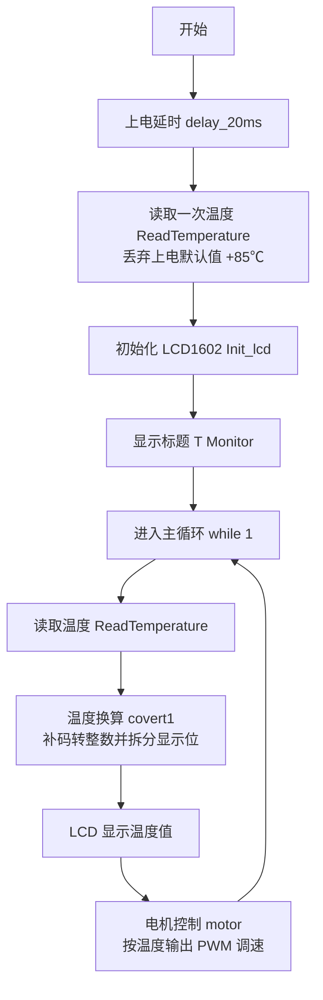
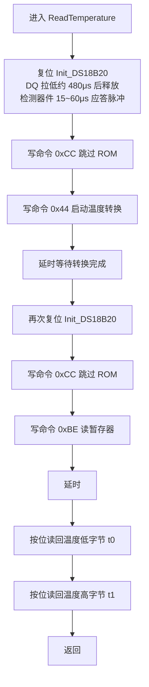
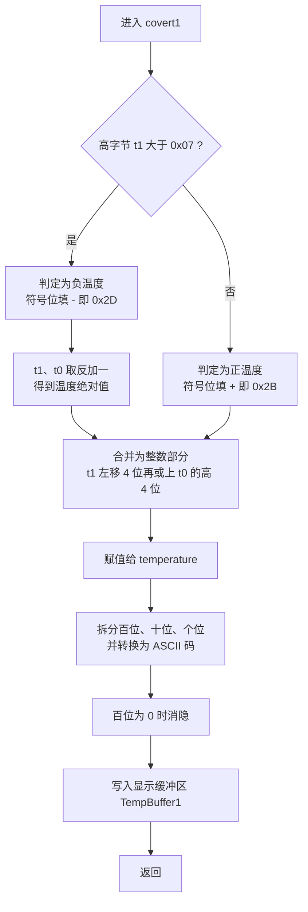
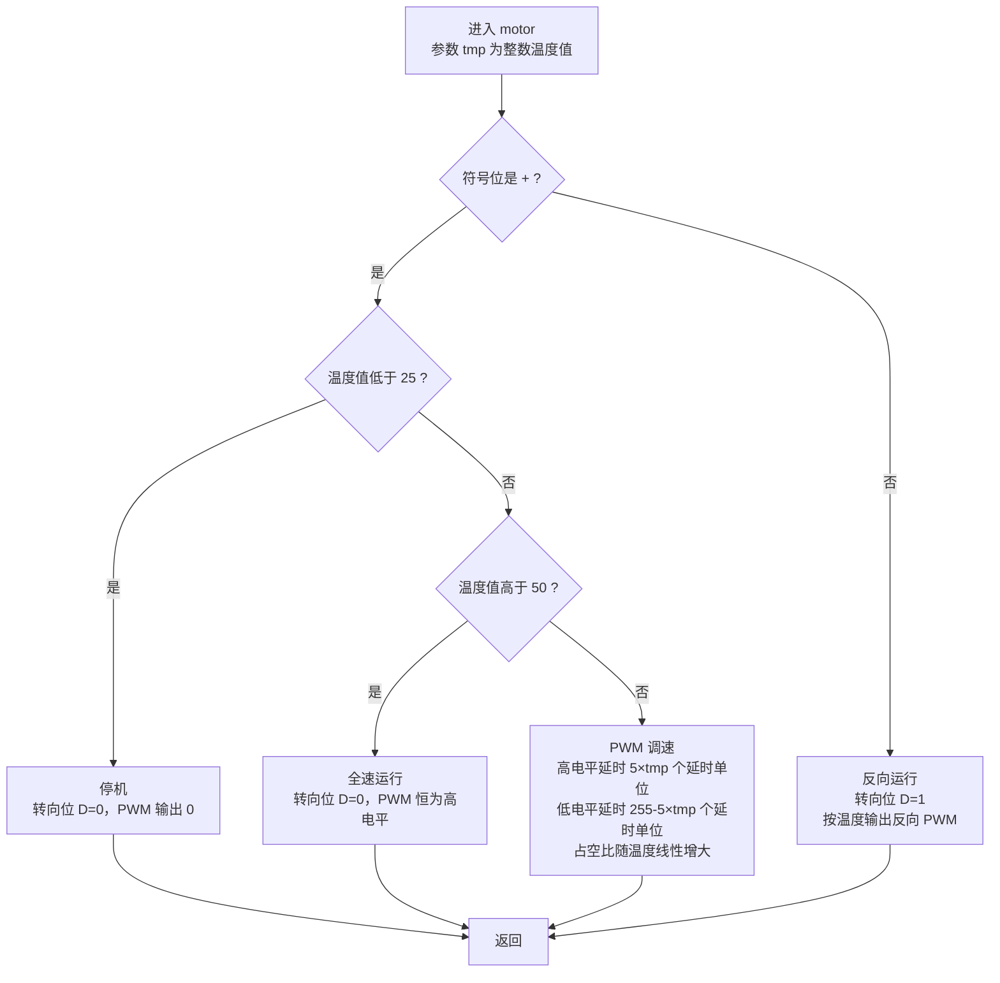
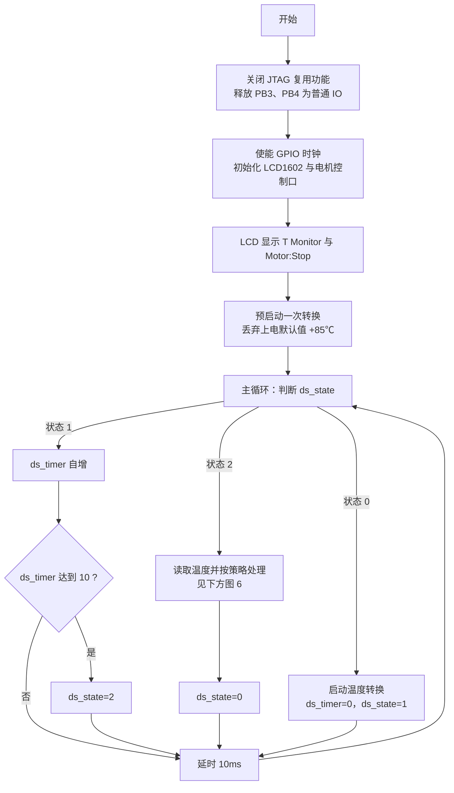
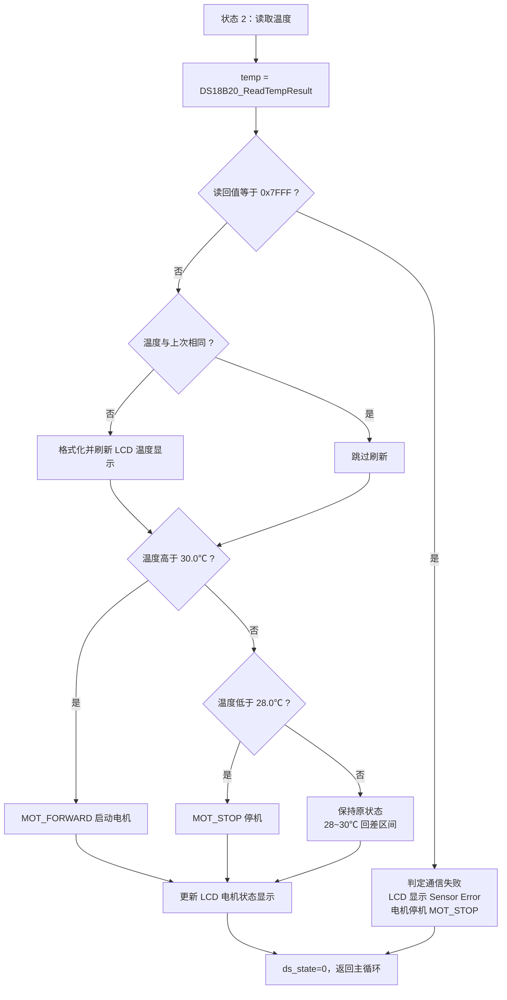

# 温度传感器实践作业 —— 程序流程图（Mermaid / ProcessOn）

> 用法：在 ProcessOn 中新建图形 → 顶部「插入」→「Mermaid」→ 把下面任意一个 ```mermaid 代码块内的内容整段粘贴进去 → 确定。
> 如果 ProcessOn 提示语法错误，把第一行的 `flowchart TD` 改成 `graph TD` 再试（老版本 mermaid 只认 graph）。

---

## 图 1　51 单片机主程序流程（main 函数）

对应报告「5.软件设计 →（1）51 单片机程序」的主流程段与源文件 `Listings\main.c`。



---

## 图 2　DS18B20 温度读取子程序流程（ReadTemperature）

对应报告「DS18B20 驱动」段。注意温度转换与读取是**两次独立的总线访问**。



---

## 图 3　温度数据处理子程序流程（covert1）

对应报告「温度数据处理 covert1()」段。



---

## 图 4　电机控制子程序流程（motor，PWM 调速）

对应报告「电机控制 motor(tmp)」段。正温度按 25℃／50℃ 分三档，负温度反向转动。



---

## 图 5　STM32 主程序与主循环状态机

对应报告「（2）STM32 程序」的「主循环结构」段。三个状态循环切换，共同完成一次 750ms 量级的温度转换与读取。



---

## 图 6　STM32 温度处理与电机回差控制（状态 2 展开）

对应报告「控制策略」与「故障处理」两段。图中 30.0℃／28.0℃ 之间的「保持原状态」即回差（滞环）区间。


